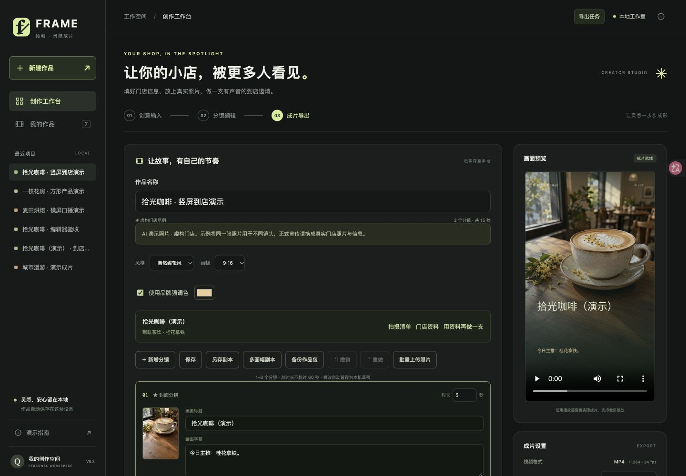

# FRAME 拾帧 · AI Video MVP V0.3

给小白商家使用的本地短视频工作台：填写门店信息、放入照片、编辑分镜，导出视频、字幕、封面和发布文案。**无需 API 密钥即可走完流程。**

支持咖啡茶饮、餐饮、烘焙、美甲、宠物、花店六类门店，以及到店、产品、活动、小店介绍四种用途。没有素材也能点击咖啡、花店、烘焙一键示例体验；示例使用明确标注的虚构门店与 AI 照片。

[V0.3 演示作品](demo/v0.3/README.md) · [完整验收路线](docs/ACCEPTANCE.md) · [V0.2 历史样片](demo/merchant/README.md)

## 启动

需要 **Python 3.10+，推荐 3.12**。首次安装依赖需要联网，之后本地模板、照片、音乐和视频合成可离线运行。

- macOS / Linux：运行 **bash start.sh**。macOS 也可双击 start.command。
- Windows：双击 **start.bat**。
- 任意系统：运行 **python bootstrap.py**。

启动器自动创建项目内的 .venv 并检查依赖版本。浏览器打开 **http://127.0.0.1:8000**，保留启动终端；Ctrl+C 停止。运行产品不需要 Node.js，中文字体与 FFmpeg 已随项目或依赖提供。

重复启动时会提示已占用的端口。同一个作品目录只允许一个工作台进程运行，退出后自动释放；单独修改端口不会绕过这项数据保护。

只检查环境、不安装或启动：运行 **python bootstrap.py --check**。详细诊断使用项目环境中的 Python：

~~~bash
.venv/bin/python doctor.py
# Windows:
.venv\Scripts\python doctor.py
~~~

诊断检查依赖、字体、FFmpeg、磁盘、数据库和可选语音，不发送网络请求、不输出密钥、不创建作品。

## 第一次制作

1. 新建作品，选择一个一键示例；或填写自己的门店资料并生成分镜。
2. 修改标题和字幕，点缩略图检查预览。展开「画面构图」调整取景与文字位置。
   还没有照片时，点「拍摄清单」查看逐幕建议，也可下载 TXT，按清单拍好再上传。
3. 保存分镜，选择画质、音乐和可用的中文配音，试听后导出。
4. 播放实际成片，打开「发布助手」下载视频与封面、一键复制对应成片的文案；也可下载整套素材，或单独下载 MP4、PNG、SRT、TXT、JSON。
5. 用「多画幅副本」制作其他比例，用「另存副本」保留不同文案，用「备份作品包」迁移到其他设备。

正式宣传请替换示例中的虚构信息和 AI 照片，核对自己的活动内容与地址。

## 已实现

| 能力 | 范围 |
| --- | --- |
| 分镜编辑 | 1–8 幕，2–20 秒/幕，总计 ≤60 秒；标题 32 字、字幕 96 字；新增、复制、排序、删除 |
| 独立口播 | 每幕最多 160 字，留空朗读字幕；画面可保持简短，配音自动延长镜头，整片最多 120 秒 |
| 照片素材 | JPG / PNG / WebP，单张 ≤8 MB、≤2000 万像素，每作品最多 40 张；批量上传、照片库复用 |
| 拍摄引导 | 每幕建议拍什么，按画幅提示横拍或竖拍；可下载含字幕和素材状态的拍摄清单 |
| 构图与品牌 | 取景、放大、完整展示、5 种背景运动、3 种文字位置、品牌色、门店角标、自选封面 |
| 草稿保护 | 按窗口独立暂存、多份草稿选择恢复、40 步撤销重做、版本冲突后的草稿另存 |
| 作品管理 | 搜索、复制、归档恢复、复用门店资料、一键创建多画幅独立副本，按当前设置批量导出 |
| 音乐 | 温暖氛围、柔和琴音、清亮节奏；8 秒试听、音量调节，配音时降低音乐音量 |
| 导出 | 720p / 1080p，H.264 / 24 fps / AAC；跨作品任务进度、排队位置、取消、历史成片；最多 3 个任务，整组校验后入队 |
| 发布准备 | 集中下载视频与封面，一键复制本次成片文案；缺失或空文件可按当前分镜重新生成 |
| 备份迁移 | 可编辑作品 ZIP 包含分镜与照片；导入创建独立副本，不覆盖原作品 |
| 设备界面 | 桌面预览随编辑保持可见；手机底部编辑、预览、保存、导出入口 |

照片会纠正方向、去除 EXIF，最长边限制为 2400px，原始文件不保留。镜头运动只作用于背景，店名与文字保持稳定；完整展示照片时保持静止以免裁切。深色品牌配色保留在装饰图形上，字幕与角标序号自动使用浅色，便于阅读。

| 画幅 | 720p | 1080p |
| --- | --- | --- |
| 9:16 | 720 × 1280 | 1080 × 1920 |
| 16:9 | 1280 × 720 | 1920 × 1080 |
| 1:1 | 720 × 720 | 1080 × 1080 |

**整套素材 ZIP** 用于查看和发布，含 MP4、SRT、PNG、TXT、JSON。**可编辑作品包 ZIP** 用于备份和迁移，含分镜与照片，不含历史视频和密钥。

导出前检查照片、文字时长、语音与磁盘。最多 3 个任务排队或处理中，逐个合成；相同版本与导出设置复用结果。历史导出保留快照，后续编辑不改变成片；取消保留作品，服务重启后的中断任务可重新导出。

## 能力边界

门店模式按填写事实编排模板，自由创意本地模式使用预设结构，**均不调用 AI**。DeepSeek 仅用于可选的自由创意分镜；画面与视频仍在本机合成。一键示例的 AI 图片是预先生成素材，应用不会联网生成实拍照片或视频。

中文配音使用 macOS 已安装的婷婷语音。Windows / Linux 禁用该选项，仍可制作字幕与音乐视频。SRT 为逐幕字幕，不是逐字卡拉 OK；独立口播开启时使用口播文案，无配音时使用画面标题和字幕。最终声音、动态效果和时长以 MP4 为准。

当前没有原始视频剪辑、账号、支付或云协作。服务默认仅监听本机，使用单个应用进程；公开部署需要另外实现认证、用户隔离、配额、持久任务系统和 HTTPS。

## 可选 AI

复制 .env.example 为 .env，填写 DEEPSEEK_API_KEY 后重启。在「自由创意」选择 DeepSeek AI 才会发送创意并产生相应 API 用量。默认模型为 deepseek-flash，可用 DEEPSEEK_MODEL 覆盖。环境变量优先于 .env，密钥只在服务端读取，不进入作品或导出包。

接口于 2026-10-23 对照 [模型文档](https://api-docs.deepseek.com/quick_start/pricing/)、[JSON Output](https://api-docs.deepseek.com/guides/json_mode/) 和 [Thinking Mode](https://api-docs.deepseek.com/guides/thinking_mode/) 核对，短分镜任务关闭思考模式。异常、空或截断输出会明确报错；测试使用模拟接口，本次未调用付费 API，未声称完成真实密钥联调。

## 数据与排错

作品位于 data/studio.sqlite3，照片在 data/assets/，成片在 data/exports/。用户数据与 .env 不纳入 Git。完整备份需先停止服务再复制整个 data 目录；单份作品可在界面备份。浏览器草稿仅在本机暂存，迁移前请保存或另存副本。

- 端口占用：在 .env 设置 PORT=8001，重启并访问对应地址。
- 安装或环境异常：检查 Python 与网络，运行 doctor.py 定位。
- 保存冲突：用「另存副本」保留当前草稿，或重新打开最新作品。
- 缺少照片或旧版发布材料：重新上传照片，保存后重新导出。
- 导入失败：请选择「可编辑作品包」，发布素材 ZIP 不能导入。
- 服务中断：保留页面草稿，重新运行启动脚本，再点击页面右上角「重新连接」并保存。
- 照片损坏：预览与导出检查会明确提示，重新上传或移除该幕照片即可继续。
- 自定义字体与数据目录：配置 VIDEO_FONT / VIDEO_DATA_DIR 后重启。

## 开发验证

~~~bash
.venv/bin/python -m pip install -r requirements-dev.txt
.venv/bin/python -m pytest -q
node --test tests/editor.test.cjs tests/http.test.cjs tests/drafts.test.cjs
node --check web/app.js
~~~

当前本地 **133 项 Python、21 项 JavaScript 测试通过**。CI 配置覆盖 Linux Python 3.10/3.11/3.12 和 Windows Python 3.12，实时结果见仓库 Actions。测试包括真实视频解码、1080p 三种画幅、稳定文字、实际音量比、配音/SRT 时轴、取消任务、快照隔离、草稿副本、多画幅回滚、作品包校验、损坏照片检测、重复启动保护与断线提示。原生语音和页面操作另通过本机浏览器验证，详见 [验收说明](docs/ACCEPTANCE.md)。

制作可分发 ZIP：运行 **python scripts/build_release.py**。文件生成在项目目录的上一级，含源码、字体、说明、测试和演示作品；采用明确的文件白名单，排除 data、.env、.venv 和 Git 数据。ZIP 内的 RELEASE-MANIFEST.json 记录逐文件 SHA-256，旁边的 .sha256 文件校验完整 ZIP。重新打包自己生成的旧包时加 **--overwrite**。首次运行该包仍需要 Python 和联网安装依赖。

app 为后端与媒体处理，web 为无构建依赖的网页，tests 为自动验收，demo 为虚构样片，docs 为使用与验收说明。bootstrap.py 负责启动，doctor.py 负责只读诊断，run.py 为服务入口。

字体使用 [Noto CJK](https://github.com/notofonts/noto-cjk)，SIL Open Font License 随文件提供。音乐由代码合成。AI 图片完整提示词见 [咖啡说明](demo/merchant/README.md) 与 [花店、烘焙说明](demo/showcase/README.md)。
