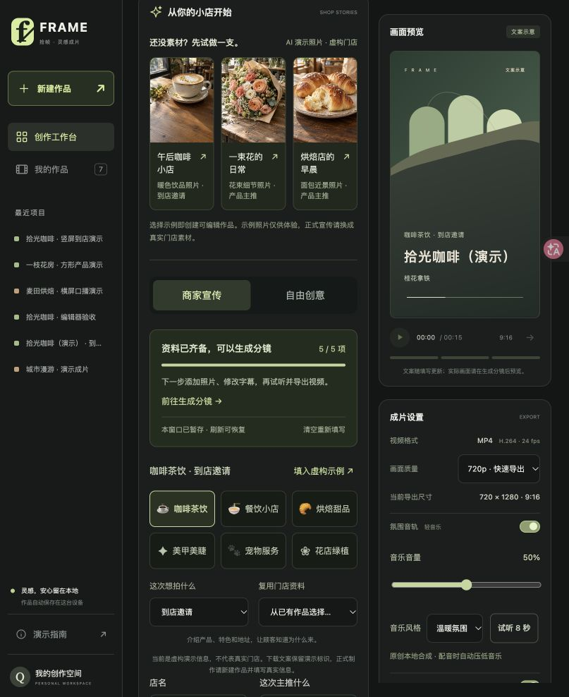

# V0.3.1 新手制作验收 · 2026-10-24

本轮从现有 V0.3 工作台继续完善，重点是生成分镜之前的填写体验。已有作品数据结构和渲染规则保持兼容。



## 本轮变化

- 必填资料进度会随输入更新，按宣传用途显示缺失字段，点击引导定位到下一项。活动宣传需要填写活动内容；资料齐备后可跳到生成按钮。
- 文案示意使用当前填写的店名、产品、特色或活动内容，空字段使用明确的填写提示。示意不是最终渲染画面；生成后可继续编辑并预览实际分镜。
- 当前窗口用 sessionStorage 暂存完整填写状态，包含切换到另一创作类型前的内容、风格、比例、时长和虚构示例标识。刷新与切换作品后可继续；其他窗口不会互相覆盖。关闭窗口后的恢复不作保证，已经生成的作品仍持久保存在本机数据库。
- 成功生成作品后清除这份填写暂存，直接进入编辑器。生成失败保留输入；列表刷新失败也不会把已经创建成功的作品显示为生成失败。生成过程中锁定表单，避免请求中的内容与显示内容不一致。
- HTML、脚本、样式在刷新时重新校验版本，避免更新后混用旧脚本。初始化期间不接受填写区操作，避免示例卡片加载引起布局变化时误点。

## 验收路线与结果

1. 只填写店名和产品，刷新页面：内容恢复，进度为 3/5，预览显示输入的店名和产品。点击下一项后焦点落在到店理由。
2. 选择活动宣传，填入虚构示例并清空活动内容：显示 5/6，下一项准确定位活动信息；补上活动后变为 6/6。
3. 切换自由创意并输入故事，改为方形、30 秒后刷新：创作类型、文字、比例、时长恢复。切回商家宣传，之前的门店内容和虚构标识仍在。
4. 切换到已有作品或一键示例，再点击新建作品：未生成的填写资料仍可继续。生成成功后再次新建：输入为空，不重复带入上一份已生成内容。
5. 390×844 手机视口：页面没有横向溢出，点击引导可到生成按钮，并成功生成 30 秒方形活动作品，进入可编辑分镜。完成后恢复默认窗口尺寸。
6. 浏览器控制台没有本轮脚本错误。本轮生成的两份测试作品已归档，仍可恢复；原有 7 份活动作品保留。

自动化：**134 项 Python + 27 项 JavaScript 测试通过**。新增覆盖填写暂存、窗口隔离、损坏和超长记录、存储失败、活动必填、事实文案，以及页面资源缓存校验。完整媒体、导入导出和编辑回归一并通过。

```sh
.venv/bin/python -m pytest -q
node --test tests/*.test.cjs
node --check web/app.js
```

制作本版本交付包：

```sh
python scripts/build_release.py --version v0.3.1 --output ../AI-Video-MVP-v0.3.1.zip
```

V0.3 的三份演示成片保持不变，见[完整验收路线](ACCEPTANCE.md)。本轮没有调用付费 AI 接口。
