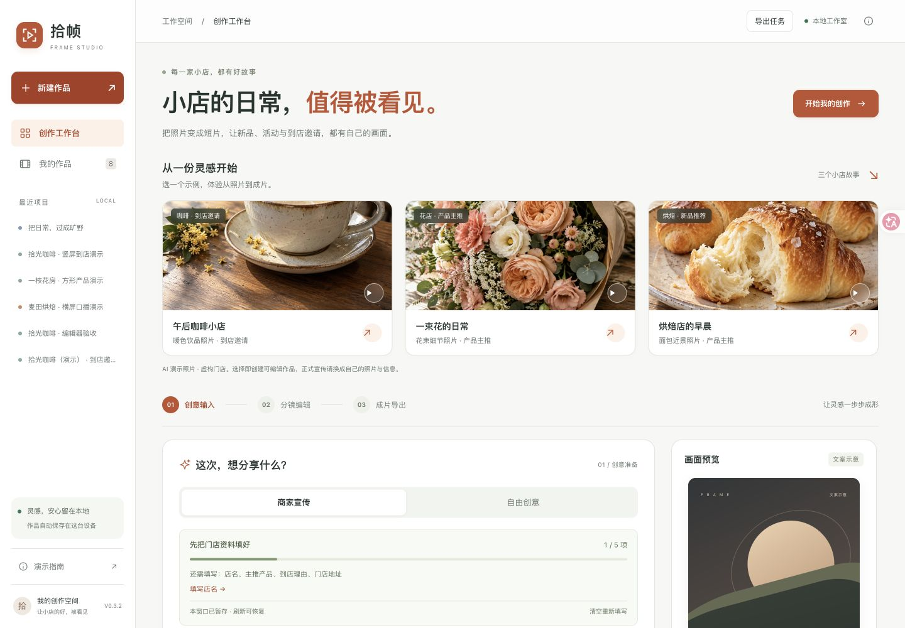
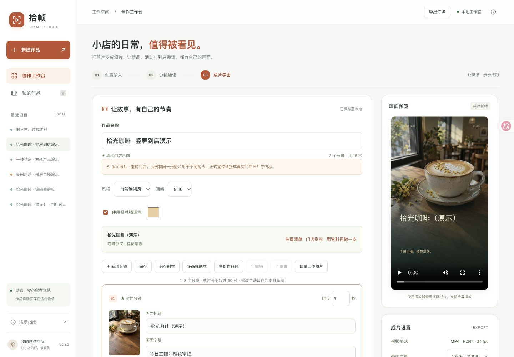

# V0.3.2 视觉与操作验收 · 2026-11-09

本轮面向首次使用短视频工具的小店商家，更新工作台视觉与信息层级。配色和布局的改进尚未经真实商家付费转化实验验证。

## 视觉变化

- 暖白背景、墨色正文、陶土橙主操作，统一品牌标识、导航、表单、编辑器、列表、导出设置和弹窗；视频模板本身保留原来的画面配色。
- 咖啡、花店、烘焙示例移到独立的灵感区域，使用大图和用途标签，并保留 AI 照片与虚构门店说明。
- 「开始我的创作」定位填写区域并聚焦对应字段。画面风格、比例和时长收进可展开设置；未创建作品时隐藏导出区。
- 打开已有作品后收起灵感区域与创作提示，缩小顶部标题，留出编辑空间。打开作品列表时回到顶部。
- 手机示例卡片横向滑动，填写区单列布局，编辑时保留底部快捷操作；保留减少动态效果的系统偏好支持。

## 实际验证

浏览器检查了 1440 × 1000 桌面、默认 777 × 988 窗口和 390 × 844 手机尺寸，未发现页面横向溢出。检查首屏、风格设置、作品列表、编辑器、实际成片、发布助手及手机底部操作。

1. 「开始我的创作」能定位填写区并将焦点放到店名；展开风格设置后所有选项可见。
2. 通过首页咖啡示例创建临时作品，进入三幕编辑器；修改名称和第一幕字幕，保存成功。
3. 在手机布局选择 720p、关闭配音、保留音乐，成功导出 720 × 1280、15 秒的 MP4；浏览器播放器 readyState 为 4，显示正确分辨率和时长。
4. 打开已有 1080p 咖啡作品，视频加载成功；发布助手可展示文案与素材下载入口。
5. 手机「画面预览」「成片导出」快捷按钮可定位对应区域。浏览器未记录本轮脚本警告或错误。
6. 本轮临时作品「视觉验收 · V0.3.2 临时作品」已归档，可恢复。原有 8 份活动作品保留。响应式检查结束后恢复浏览器默认窗口尺寸。

自动化回归：**134 项 Python + 27 项 JavaScript 全部通过**；JavaScript 语法检查与 Git 差异空白检查通过。Python 测试存在一条依赖库弃用提示，不影响测试结果。未新增付费接口调用。

```sh
.venv/bin/python -m pytest -q
node --test tests/*.test.cjs
node --check web/app.js
git diff --check
```

## 截图

实际浏览器截图，页面中的门店和照片均为演示素材。






